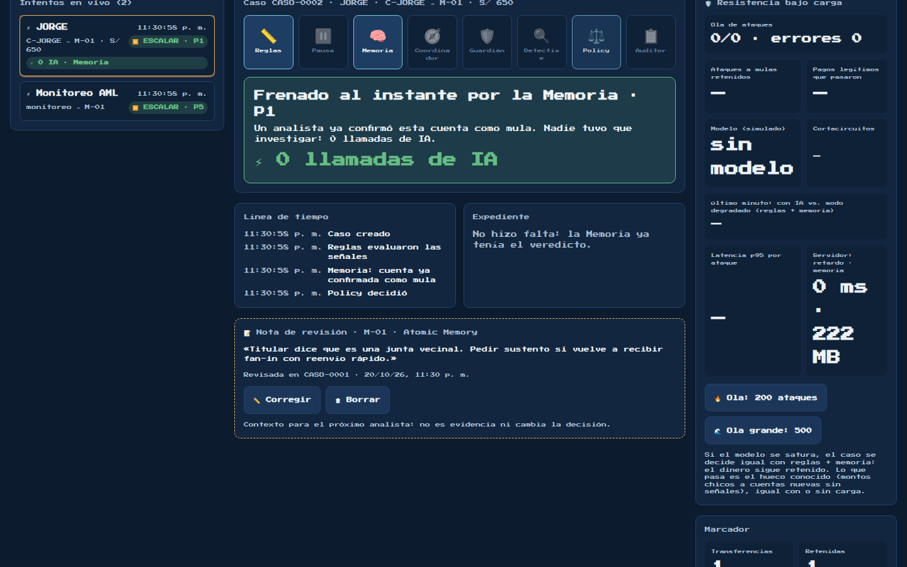
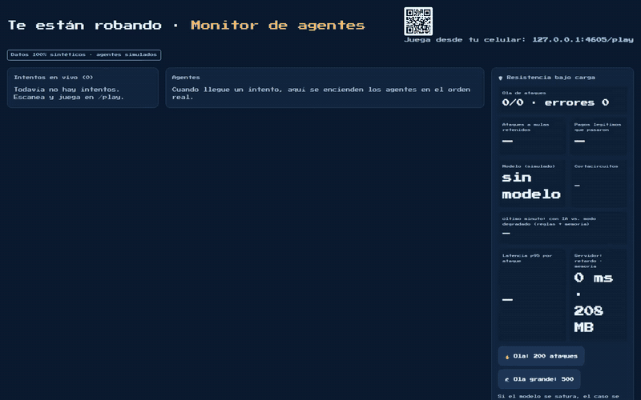

# Notas de revisión entre casos

Captura y video de la aplicación real en localhost. Los casos y agentes son sintéticos, como indica el monitor. Atomic Memory usa el proveedor HTTP local de `tests/fixtures/servir-atomicmemory-fixture.ts`; no es una cuenta real del servicio.

El video muestra guardar una nota revisada, recuperarla al abrir otro caso de la misma cuenta y corregirla. La confirmación de mula pertenece al flujo de demostración existente: la nota de Atomic Memory no cambia esa decisión.

Para reproducir, iniciar `npx tsx tests/fixtures/servir-atomicmemory-fixture.ts` y usar la URL que imprime como `ATOMICMEMORY_API_URL`. Configurar `ATOMICMEMORY_API_KEY=fixture-key` y `DEMO_TOKEN` local, e iniciar `npm run dev -- -H 127.0.0.1 -p 4605`. Abrir `/monitor?token=<DEMO_TOKEN>`, crear un caso de muestra y guardar una nota sobre la cuenta destino. Ver README y `.env.example` para la configuración real.

[Video WebM](demo.webm)
