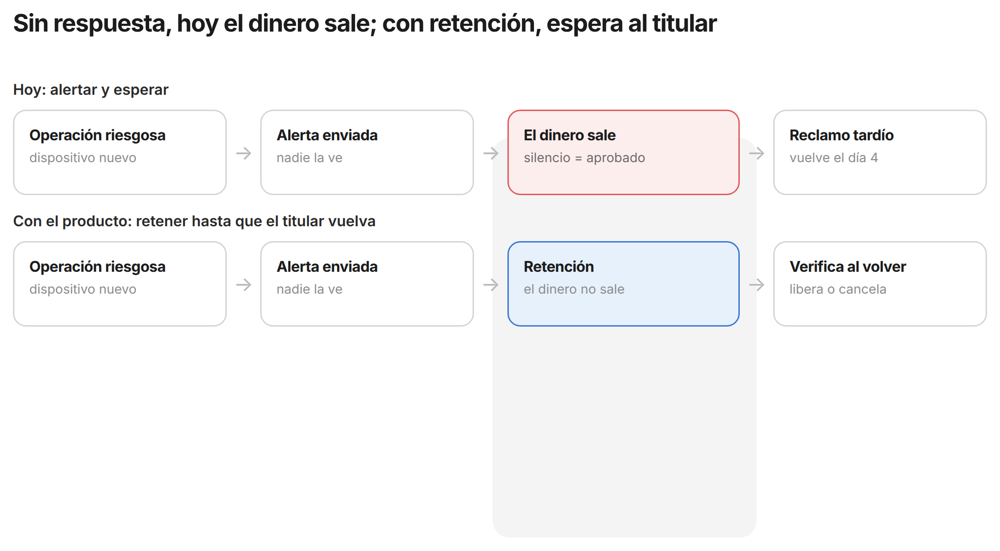
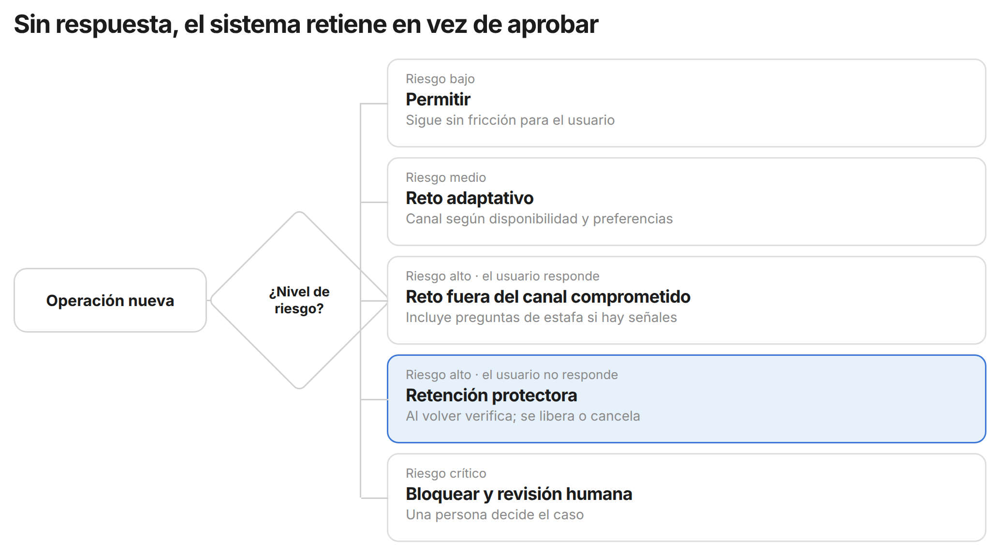

# Brief UX conceptual — Seguridad Financiera Adaptativa

17 de octubre de 2026

Este brief define el concepto, el público, el alcance y las capacidades de la experiencia, no la interfaz. El objetivo de UX es diseñar cómo se siente estar protegido cuando no puedes responder, antes de dibujar una sola pantalla.

## Concepto

La promesa es: **seguridad financiera que sigue funcionando aunque tú no estés mirando.** Hoy un banco detecta una operación sospechosa en segundos, pero la protección real depende de que el titular vea la alerta y responda a tiempo.

- **Problema:** el flujo actual es alerta → esperar al usuario → el usuario reacciona. Si el usuario está sin señal, durmiendo, sin teléfono o manipulado, se abre una ventana de exposición.
- **Tesis:** la seguridad de una cuenta no debería caer cuando el titular está temporalmente indisponible.
- **Primitivo de producto:** una capa que combina riesgo, disponibilidad, confiabilidad del canal, preferencias del usuario y contexto, y decide entre permitir, retener, verificar o escalar.
- **Reencuadre clave para UX:** no es "seguridad para personas vulnerables". Es seguridad resiliente a la disponibilidad humana, y sirve a cualquier usuario.

La pregunta que la experiencia cambia: de "¿puedes confirmar esto ahora?" a "¿cómo protegemos tu intención cuando no puedes responder?".

Los dos recorridos empiezan igual: una operación riesgosa y una alerta que nadie ve. Solo cambia el tercer paso, y ese paso es el que UX tiene que diseñar.

La seguridad tiene cuatro dimensiones que la experiencia debe distinguir:

| Dimensión | Pregunta | ¿La resuelve el sistema actual? |
| --- | --- | --- |
| Identidad | ¿Es el titular? | Sí: clave, OTP, biometría |
| Autorización | ¿Tiene permiso para esta acción? | Sí |
| Intención | ¿Es su voluntad real o lo están manipulando? | Poco |
| Disponibilidad | ¿Puede participar en una verificación ahora? | No |

## Público objetivo

El público son titulares de cuentas y billeteras digitales en Latinoamérica, empezando por Perú, segmentados por **su capacidad de responder de forma segura en ese momento**, no por edad, ingreso o discapacidad. Una misma persona cambia de estado en pocas horas.

| Estado | Ejemplo | Qué falla hoy | Qué necesita de la experiencia |
| --- | --- | --- | --- |
| A. Inmediato | En casa, con el teléfono | Igual puede caer en phishing o vishing | Interrupción clara ante estafa |
| B. Demorado | Durmiendo, manejando, en vuelo | La alerta caduca antes de verla | Que el silencio no sea aprobación |
| C. Inalcanzable | Zona rural, viaje sin roaming, hospital | El flujo espera una respuesta que no llega | Retención temporal y recuperación al volver |
| D. Canal inaccesible | Persona sorda ante una llamada, persona ciega ante un reto visual | El reto existe pero no se puede usar | Canal alternativo elegido por el usuario |
| E. Canal comprometido | Celular robado, cambio de SIM, acceso remoto | Se verifica por el mismo canal atacado | Verificación fuera de ese canal |
| F. Autenticado pero manipulado | Sigue instrucciones de un estafador | Identidad válida, intención dañada | Preguntas de contexto, pausa, salida segura |
| G. Dispositivo compartido | Teléfono familiar, pequeño comercio | Confunde confianza en el equipo con confianza en la persona | Privacidad y autonomía del titular |
| H. Recursos limitados | Teléfono antiguo, plan prepago, señal intermitente | Los mecanismos fallan por infraestructura | Funcionar con poca conexión y poco equipo |

Para el MVP, los estados prioritarios son C (inalcanzable), F (manipulado), D (canal inaccesible) y E (canal comprometido).

**Contexto que justifica el foco:** en Perú, 47% de usuarios de servicios financieros digitales estuvo expuesto a fraude en 2025 y, de los afectados, 11% dejó de usar el servicio. En Latinoamérica, los intentos de estafa por ingeniería social crecieron 155% en 2025. El fraude no solo cuesta dinero: destruye confianza y adopción.

## Stakeholders

La experiencia tiene dos caras: la del titular, que vive la protección, y la del operador del banco, que la gestiona y la explica. UX debe diseñar ambas.

| Actor | Rol en la experiencia | Lo que necesita | Su tensión |
| --- | --- | --- | --- |
| Titular de la cuenta | Usuario principal | Usar su dinero con autonomía y seguir protegido fuera de su patrón | No quiere perder dinero ni ser bloqueado |
| Persona de apoyo (familiar) | Opcional, solo si el titular la elige | Ayudar sin volverse dueña de la cuenta | Apoyo voluntario, nunca dependencia obligatoria |
| Equipo de fraude y riesgo | Operador interno | Contexto suficiente para decidir sin falsos positivos | Quiere bloquear más fraude sin bloquear clientes |
| Soporte al cliente | Operador interno | Reconstruir qué pasó con evidencia | Los casos llegan tarde y sin datos |
| Producto digital | Dueño del flujo | Seguridad fuerte sin fricción innecesaria | Cada control extra sube el abandono |
| Cumplimiento | Auditor | Decisiones explicables y accesibles | Trazabilidad y obligaciones de accesibilidad |
| Finanzas (comprador) | Paga el producto | Menos pérdida, costo y reclamos | Mide todo en impacto económico |

Para el MVP, UX diseña dos perfiles: **el titular** y **el analista de fraude o soporte** que revisa la evidencia.

## Alcance

El MVP es una demo de 30 horas que prueba una sola idea: **una cuenta sigue protegida ante una operación anómala aunque el usuario no pueda responder, sin bloquearlo todo a ciegas.**

| Entra en el MVP | Queda fuera |
| --- | --- |
| Cuenta simulada: saldo, historial, beneficiarios, dispositivo | Core bancario real y red interbancaria |
| Preferencias de protección configuradas por el usuario | KYC y onboarding completo |
| Eventos de riesgo: beneficiario nuevo, monto anómalo, dispositivo nuevo, acceso remoto, usuario inalcanzable | Modelo de machine learning entrenado |
| Cuatro modos de usuario: disponible, inalcanzable, dispositivo comprometido, canal alternativo | App bancaria completa |
| Decisión explicada: por qué el sistema actuó así | Catálogo de 20 tipos de fraude |
| Tres escenarios reproducibles | Intercambio de señales entre bancos |

El producto final vive como infraestructura (motor de políticas, capa de verificación, API o SDK) dentro del banco o la billetera, no como un chatbot ni una app aparte. Para UX, eso significa diseñar **momentos y reglas de experiencia** que el banco integra en sus propios canales.

## Características conceptuales

Son seis capacidades. Cada una describe qué debe vivir el usuario, no cómo se ve.

| Capacidad | Qué vive el usuario | Pregunta de UX a resolver | Prioridad MVP |
| --- | --- | --- | --- |
| Retención protectora | Ante riesgo alto y sin respuesta, la operación queda en pausa, no aprobada ni bloqueada para siempre | ¿Cómo entiende al volver qué se retuvo, por qué y qué puede hacer? | Alta |
| Verificación adaptativa | El sistema elige el reto según riesgo, disponibilidad, canal y preferencias de accesibilidad | ¿Cómo se elige un canal sin que el usuario declare un diagnóstico? | Alta |
| Políticas de protección propias | El usuario define antes reglas para cuando no esté: "en viaje, beneficiario nuevo sobre S/500 se retiene" | ¿Cómo se configuran sin conocimiento técnico y sin miedo? | Alta |
| Interrupción de estafa | Si todo está autenticado pero el contexto es peligroso, el sistema pregunta y frena | ¿Cómo interrumpir a alguien presionado sin acusarlo ni humillarlo? | Alta |
| Recuperación confiable | Métodos preacordados: segundo dispositivo, contacto voluntario, llave física, presencial, videollamada accesible | ¿Cómo recupera control sin depender de un tercero? | Media |
| Línea de tiempo de evidencia | Una historia clara: acceso → dispositivo → beneficiario → monto → alertas → respuestas → acciones | ¿Cómo la lee un titular y cómo la lee un analista? | Alta |

Fuera del MVP, para versiones futuras: un modo de vigilancia reforzada después de una filtración o robo, e intercambio de señales de fraude entre instituciones.

## Modelo de decisión

El sistema combina riesgo y disponibilidad para elegir una de cinco respuestas. La retención protectora es el centro del producto: es lo que hoy no existe cuando el usuario no puede responder.

La IA reúne contexto y explica, pero la decisión final la toma un motor de reglas determinista. UX diseña cómo se vive y se explica cada una de estas cinco salidas.

## Escenarios

Tres recorridos conceptuales sostienen la demo. UX debe mapear cada uno como un viaje con momentos, emociones y decisiones, no como pantallas.

### 1. Viajero sin señal (estado C)

1. El usuario tiene un historial normal y sale de viaje; queda inalcanzable.
2. Un dispositivo nuevo intenta una transferencia grande a un beneficiario nuevo.
3. El sistema detecta el riesgo y envía una alerta que nadie responde.
4. El sistema **no interpreta el silencio como aprobación** y retiene la operación.
5. El usuario vuelve 48 horas después y verifica por un canal alternativo.
6. La operación se cancela o se libera, y el usuario ve por qué.

**Momento clave de UX:** el regreso. Qué entiende, qué siente y qué decide en los primeros segundos.

### 2. Autenticado pero manipulado (estado F)

1. Dispositivo legítimo y biometría correcta.
2. Beneficiario nuevo y transferencia fuera de su patrón.
3. El sistema activa un reto específico de estafa: pregunta si alguien le está guiando.
4. Aplica una pausa de enfriamiento o escala a revisión humana.

**Momento clave de UX:** la interrupción. Debe romper el guion del estafador sin culpar a la víctima y con una salida segura.

### 3. Canal inaccesible (estado D)

1. El reto estándar falla, por ejemplo una llamada para alguien que no puede usar voz.
2. El sistema elige el método alternativo que el usuario configuró.
3. El usuario completa la verificación solo, sin tercero obligatorio.

**Momento clave de UX:** la configuración previa. Cómo el usuario expresa "la voz no me sirve" como preferencia, no como diagnóstico.

## Principios de experiencia y límites éticos

El principio rector: **no maximizar bloqueos, maximizar protección útil con el menor daño por falsos positivos y exclusión.**

### Principios

1. **El silencio no es aprobación.** Sin respuesta, el sistema protege; no da por buena la operación.
2. **Proteger por grados.** Entre permitir y bloquear existen retener, verificar y escalar.
3. **El usuario define su protección.** Las reglas para cuando no esté son suyas y voluntarias.
4. **Toda decisión se explica.** El usuario y el analista ven por qué se actuó.
5. **Nunca verificar por el canal atacado.** Si el teléfono está comprometido, no sirve para confirmar.
6. **Autonomía sin terceros obligatorios.** Apoyo voluntario, nunca dependencia.
7. **Accesibilidad desde el concepto.** No como agregado al final.
8. **Pocas alertas, bien elegidas.** El exceso de avisos enseña a ignorarlos.
9. **Siempre una salida de emergencia.** Un viajero debe poder pagar un hotel aunque haya una retención.

### Límites que UX no puede cruzar

- Nunca usar edad, discapacidad o nivel socioeconómico como señal de fraude. Se adapta el canal, no se penaliza a la persona.
- No inferir datos sensibles. Preferir "la voz no está disponible" a "el usuario es sordo", y "modo lector de pantalla" a un diagnóstico.
- La IA no mueve dinero ni decide sola sobre fondos. La decisión final es de un motor de reglas y, en casos extremos, de una persona.
- En coerción la víctima puede decir "sí, quiero transferir". La experiencia necesita fricción contextual, pausa, salida segura y revisión humana.
- No llamar "inclusivo" a algo solo por agregar lectura en voz alta. Se valida con usuarios reales y estándares como WCAG.
- En Perú, las entidades financieras deben permitir que personas con discapacidad operen sin exigir la presencia de un tercero.

## Métricas de éxito

La métrica norte es el **tiempo hasta la acción protectora**: desde la primera señal de riesgo hasta una acción que realmente limita la pérdida. No es el tiempo en que se envía una alerta.

| Tipo | Métrica | Dirección buscada |
| --- | --- | --- |
| Protección | Tiempo hasta la acción protectora | Baja |
| Protección | Pérdida evitada por fraude | Sube |
| Fricción | Operaciones legítimas bloqueadas o demoradas | Baja |
| Fricción | Abandono durante un reto | Baja |
| Accesibilidad | Retos completados por el canal disponible | Sube |
| Accesibilidad | Casos que requieren ayuda de un tercero | Baja |
| Operación | Minutos de analista por caso | Baja |
| Operación | Contactos a soporte por incidente | Baja |

Experimentos que UX puede apoyar: reto adaptativo frente a reto fijo en tres estados de usuario; advertencia de estafa contextual frente a advertencia genérica; y tiempo de investigación con y sin línea de tiempo de evidencia.

## Entregables y preguntas abiertas

Lo que se espera de UX en esta fase es conceptual. Las pantallas vienen después.

### Entregables

- [ ] Mapa de estados del usuario (A a H) con sus transiciones y lo que cambia en la experiencia en cada uno
- [ ] Tres journeys conceptuales, uno por escenario, con momentos clave, emociones y puntos de decisión
- [ ] Modelo mental de la retención protectora: cómo se explica "tu dinero está en pausa para protegerte"
- [ ] Concepto de políticas de protección propias: qué reglas, en qué lenguaje, con qué valores por defecto
- [ ] Concepto de la interrupción de estafa: tono, preguntas y salida segura
- [ ] Concepto de la línea de tiempo de evidencia en dos versiones: titular y analista
- [ ] Guía de lenguaje y tono para comunicar riesgo sin generar pánico ni culpa

### Preguntas abiertas

- ¿Cuánto tiempo puede durar una retención antes de dañar al usuario, y quién lo decide?
- ¿Los usuarios aceptarían configurar reglas más estrictas para cuando no estén disponibles? Es una hipótesis sin validar.
- ¿Cómo detecta el sistema que el usuario está inalcanzable sin vigilar su ubicación?
- ¿Qué métodos de recuperación son realistas para alguien con un teléfono antiguo y plan prepago?
- ¿Cómo funciona la salida de emergencia sin abrirle una puerta al atacante?

Para validar, el equipo sugiere entrevistar en este orden: fraude y riesgo, soporte, producto digital, usuarios que sufrieron una operación no reconocida, usuarios con barreras de accesibilidad y cumplimiento. Con usuarios, evitar "¿usarías una app que…?" y preguntar por la última vez que vieron una operación extraña.

Fuente: carpeta `docs/tony/adaptive_financial_security_docs` del repositorio del equipo (módulos 00 a 18).
